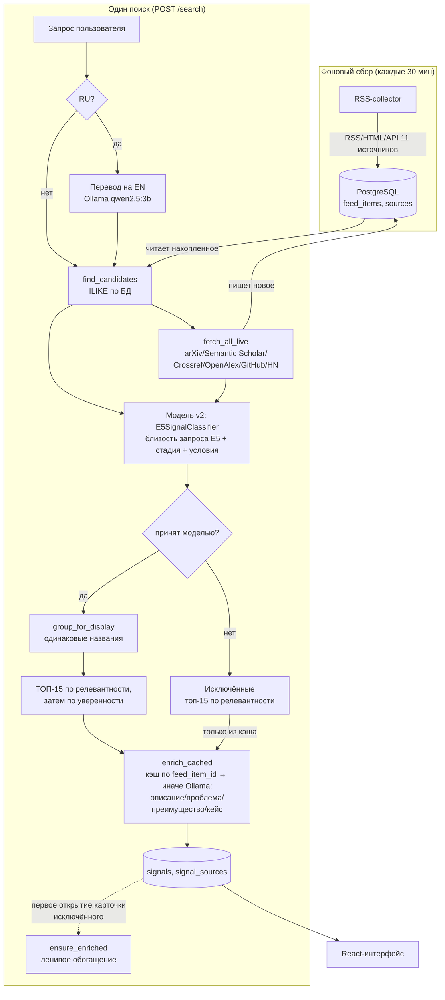

# Пайплайн обработки данных

Краткое техническое описание — как запрос пользователя превращается в
ТОП-15 слабых сигналов. Методология отбора признаков и обучения модели
подробно описана отдельно: `Модель_и_методология/Методология_и_инструкция.md`

## Архитектура

## Шаги (`backend/app/pipeline/orchestrator.py::run_search`)

1. **Перевод запроса** (`enrichment.py::translate_query_to_english`) — если
   запрос не на английском, переводится через Ollama (`temperature=0`,
   детерминированно) до поиска. Оригинал сохраняется в БД без изменений,
   переведённая версия используется только для поиска кандидатов.
2. **Поиск кандидатов**:
   - `candidates.py::find_candidates` — ILIKE по заголовку/summary в
     накопленном корпусе (`feed_items`, пополняется RSS-collector'ом).
   - `live_sources.py::fetch_all_live` — live-поиск по 9 внешним API
     (arXiv, Semantic Scholar, Crossref, OpenAlex, GitHub, Hacker News,
     гранты: NSF, UKRI Gateway to Research, CORDIS)
     в параллельных потоках: время фазы определяет самый медленный
     источник, а не сумма (retry на 429 у одного не задерживает остальные);
     найденное сразу пишется в ту же таблицу `feed_items` (дедуп по
     `url_hash`), обогащая корпус для будущих запросов.
3. **Скоринг** — модель v2 (`classifier_v2.py::E5SignalClassifier.score_batch`,
   комплект аналитика в `backend/app/models/v2/`) оценивает всех кандидатов
   одним батчем и с учётом **исходного** запроса — E5 мультиязычный,
   перевод нужен только внешним API. Три независимые проверки:
   - **смысл запроса и статьи** — косинусная близость E5
     (`multilingual-e5-small`) запроса и лучшего фрагмента статьи,
     порог `RELEVANCE_THRESHOLD` = 0.79 (аналитик подобрал 0.8 на validation,
     снижен: у русского запроса к английскому тексту близость ниже);
   - **условия запроса** («для банков», «чипы», «федеративное»…) должны
     явно встречаться в тексте (`relevance.py::CONCEPTS`);
   - **стадия технологии** — классификатор (LogisticRegression +
     калибровка) на E5-векторах и шести текстовых признаках
     (исследования, пилоты, массовое внедрение, документация, бизнес-новости,
     финансирование) → слабый сигнал / зрелая технология / шум, порог 0.6.

   Текст короче 60 слов не оценивается как сигнал («Недостаточно текста»).
   В `explanation` пишутся причина решения, релевантность, сработавшие
   признаки (`key_predictors`) и ближайший к запросу фрагмент.
   Прежняя модель v1 (TF-IDF → LogisticRegression, только EN) включается
   переменной `MODEL_VERSION=v1`.
4. **Отбор**:
   - принятые моделью (релевантны, условия подтверждены, класс «слабый
     сигнал» с уверенностью ≥ 0.6, достаточно текста) — кандидаты в сигналы;
   - остальные — в «Исключённые» (15 самых релевантных среди отклонённых,
     `SEARCH_EXCLUDED_LIMIT`) с конкретной причиной от модели.
5. **Группировка для отображения** (`display_grouping.py`) — записи с
   одинаковым названием схлопываются в одну карточку. На скоринг не
   влияет, только на то, сколько источников показано у одного сигнала.
6. **ТОП-15** — `SEARCH_TOP_N`, сортировка по релевантности запросу, затем
   по уверенности модели. Если подходящих меньше 15 — выдача короче, мусором
   не добивается.
7. **LLM-обогащение** (`enrichment_service.py`) — для включённых
   сигналов локальная Ollama (qwen2.5:3b) генерирует описание технологии,
   решаемую проблему, потенциальное преимущество и кейс-пример по тексту
   источника (`format="json"` — грамматически ограниченный вывод). Модель
   не сочиняет из общих знаний — если в тексте нет данных, явно пишет
   «не указано в источнике». Результат кэшируется по `feed_item_id`
   (таблица `signal_enrichments`, с именем модели): один и тот же материал
   в разных запросах повторно в LLM не отправляется. У исключённых при
   поиске подставляется только кэш, а недостающее описание
   досчитывается лениво — при первом открытии карточки
   (`ensure_enriched`, один вызов LLM, затем сохраняется).
8. **Запись** — `Signal`/`SignalSource` в Postgres, `is_primary` у
   источника, чей текст реально ушёл в LLM.

## Почему так, а не иначе — ключевые решения

- **Live-поиск дублирует часть логики RSS-collector** (arXiv, Semantic
  Scholar, Crossref) намеренно — backend не должен зависеть от чужого
  Docker-образа при разворачивании.
- **Смысл запроса и стадия технологии разделены** (модель v2) — раньше
  модель стадии заодно «угадывала» тему, и в топ попадали соседние темы.
  Теперь статья должна пройти обе проверки независимо.
- **Энкодер E5 не хранится в git** — 135 МБ, файлы байт в байт совпадают с
  `intfloat/multilingual-e5-small`; Docker-образ качает их при сборке
  (`models/v2/download_encoder.py`, проверка sha256 по зафиксированной
  ревизии).
- **Группировка отображения отделена от скоринга** — каждый кандидат
  получает индивидуальную оценку до группировки; группировка только
  схлопывает вывод, не может задним числом изменить, прошёл кандидат
  порог или нет.