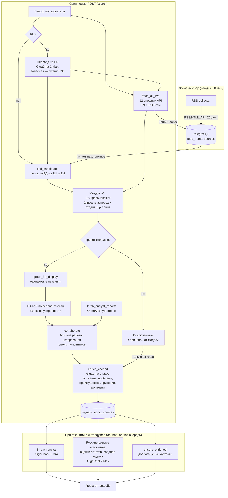

# Пайплайн обработки данных

Краткое техническое описание — как запрос пользователя превращается в
ТОП-15 слабых сигналов. Методология отбора признаков и обучения модели
подробно описана отдельно: `Модель_и_методология/v2/Методология_v2.md`
(текущая модель) и `Модель_и_методология/v1/Методология_и_инструкция.md` (прежняя).

## Архитектура

## Шаги (`backend/app/pipeline/orchestrator.py::run_search`)

1. **Перевод запроса** (`enrichment.py::translate_query_to_english`) — если
   запрос на русском, он переводится GigaChat 2 Max (минимальная temperature)
   для зарубежных API; при недоступности GigaChat — локальной qwen2.5:3b.
   Оригинал сохраняется и используется дальше: модель отбора мультиязычная,
   русскоязычные базы ищутся по исходному запросу.
2. **Поиск кандидатов**:
   - `candidates.py::find_candidates` — поиск по накопленному корпусу
     (`feed_items`, пополняется RSS-collector'ом) и по переводу, и по
     исходному запросу; для русских слов — по основе, чтобы
     «микрофлюидные» находило «микрофлюидных».
   - `live_sources.py::fetch_all_live` — параллельный live-поиск по 12 API:
     arXiv, Semantic Scholar, Crossref, OpenAlex, Europe PMC, GitHub,
     Hacker News, гранты NSF, UKRI Gateway to Research, CORDIS — по переводу;
     OpenAlex с фильтром `language:ru` и КиберЛенинка — по исходному
     русскому запросу. Время фазы определяет самый медленный источник;
     падение одного не роняет остальные. Найденное пишется в `feed_items`
     (дедуп по `url_hash`) и обогащает корпус для будущих запросов.
3. **Скоринг** — модель v2 (`classifier_v2.py::E5SignalClassifier.score_batch`,
   комплект аналитика в `backend/app/models/v2/`) оценивает всех кандидатов
   одним батчем по исходному запросу. Три независимые проверки:
   - **смысл запроса и статьи** — косинусная близость E5
     (`multilingual-e5-small`) запроса и лучшего фрагмента статьи,
     порог `RELEVANCE_THRESHOLD` = 0.79 (аналитик подобрал 0.8 на validation,
     снижен: у русского запроса к английскому тексту близость ниже);
   - **условия запроса** («для банков», «чипы», «федеративное»…) должны
     явно встречаться в тексте (`relevance.py::CONCEPTS`);
   - **стадия технологии** — классификатор (LogisticRegression +
     калибровка) на E5-векторах и шести текстовых признаках
     (исследования, пилоты, массовое внедрение, документация, бизнес-новости,
     финансирование) → слабый сигнал / зрелая технология / шум, порог 0.6.

   Текст короче 60 слов не оценивается как сигнал («Недостаточно текста»).
   В `explanation` пишутся причина решения, оценки классов, релевантность и
   порог, сработавшие признаки и ближайший к запросу фрагмент статьи.
   Прежняя модель v1 (TF-IDF → LogisticRegression) включается
   переменной `MODEL_VERSION=v1`.
4. **Отбор**:
   - принятые моделью (релевантны, условия подтверждены, класс «слабый
     сигнал» с уверенностью ≥ 0.6, достаточно текста) — кандидаты в сигналы;
   - остальные — в «Исключённые» (15 самых релевантных среди отклонённых,
     сначала отклонённые по существу, затем по короткому тексту) с причиной
     от модели. Одна статья с разных площадок — одна строка.
5. **Группировка для отображения** (`display_grouping.py`) — записи с
   одинаковым названием схлопываются в одну карточку; на скоринг не влияет.
6. **ТОП-15** — `SEARCH_TOP_N`, сортировка по релевантности запросу, затем
   по уверенности модели. Если подходящих меньше 15 — выдача короче, мусором
   не добивается.
7. **Подтверждения и оценки аналитиков** (`corroboration.py`) — ТЗ требует,
   чтобы сведения подтверждались независимыми источниками. Для каждого
   сигнала ТОП-15:
   - **близкие работы** — другие публикации (среди кандидатов поиска и по
     узкому поиску в БД по ключевым словам названия), которые по смыслу
     (E5) входят в 1% самых близких пар внутри темы и не ниже 0.90.
     Порог относительный: у E5 любые две статьи одной темы близки
     (медиана ~0.86), абсолютный порог слепил бы всё подряд;
   - **цитирования OpenAlex** — работы, цитирующие публикацию сигнала, не
     дальше по смыслу, чем типичная пара статей в теме; по годовым
     цитированиям — предиктор «Рост цитирований»;
   - **оценки аналитиков** — отчёты из OpenAlex (`type:report`, ищутся по
     запросу отдельно от кандидатов) и аналитических лент (McKinsey,
     Stanford HAI, ВШЭ «Экспертиза», BIS, FS-ISAC). Сначала берутся отчёты,
     близкие к самому сигналу; если таких нет — отчёты по теме запроса
     (с пометкой в интерфейсе). Проектные отчёты (deliverables и т. п.)
     отсеиваются по названию.

   Копии той же статьи с других площадок подтверждением не считаются.
   Тип связи хранится в `signal_sources.relation` (primary / similar /
   cites / assessment / assessment_topic) и показывается в интерфейсе.
8. **LLM-обогащение** (`enrichment.py`, `enrichment_service.py`) — для
   включённых сигналов GigaChat 2 Max по тексту основного источника пишет:
   описание (что предлагает именно эта публикация), решаемую проблему,
   преимущество, 2–4 **критерия слабого сигнала** с фактами из текста и
   **проявления** — конкретные факты применения (компания, пилот, патент).
   Ответ строго по JSON-схеме и на русском; шаблонные заглушки модели
   (`{{company}}`) и мусорные пункты отбрасываются. Результат кэшируется
   по `feed_item_id` (`signal_enrichments`): один материал в разных
   запросах повторно в LLM не отправляется. У исключённых при поиске
   подставляется только кэш, недостающее досчитывается при первом
   открытии карточки (`ensure_enriched`).
9. **Запись** — `Signal`/`SignalSource` в Postgres.

## Генерация при открытии (`source_summary_service.py`, `summary_service.py`)

Чтобы не удлинять поиск, часть текстов генерируется, когда пользователь их
открывает, через фоновые очереди; интерфейс опрашивает статус:

- **Итоги поиска** — вывод по ТОП-15 (GigaChat-3-Ultra) по оригинальным
  аннотациям: обзор и 2–3 ключевых сигнала; «Самые уверенные» считаются без LLM.
- **Русские резюме зарубежных источников** (ТЗ) — на странице источников,
  с отметкой «Резюме сгенерировано ИИ · модель».
- **Оценки аналитиков** — краткая оценка каждого отчёта и **сводная оценка**
  (стадия развития / первые применения / массовое внедрение) из
  фиксированного набора значений с обоснованием; без отчётов — «не найдены».

## Модели и отказоустойчивость

- Отбор и ранжирование — только локальные модели (E5 + классификатор), LLM
  в нём не участвуют. Облачные модели описывают уже отобранное по текстам
  источников; модель каждого ответа сохраняется, показывается в интерфейсе
  и пишется в лог (ТЗ).
- У аккаунта GigaChat один поток — все вызовы идут строго по одному.
- **Запасная модель:** если GigaChat недоступен (сеть, ошибка, исчерпаны
  повторы), он на 2 минуты помечается недоступным, и всё делает локальная
  qwen2.5:3b. Ответы запасной модели пересоздаются на GigaChat при
  следующем открытии, когда он снова доступен.
- **OpenAlex** с 2026 г. тарифицирует запросы: без ключа ~2 поиска в сутки
  на IP, с бесплатным ключом (`OPENALEX_API_KEY`) — около 90. На один
  поиск уходит до ~50 запросов (live-поиск, отчёты, цитирования), к API
  идут не более 3 параллельных запросов.

## Почему так, а не иначе — ключевые решения

- **Live-поиск дублирует часть логики RSS-collector** (arXiv, Semantic
  Scholar, Crossref) намеренно — backend не должен зависеть от чужого
  Docker-образа при разворачивании.
- **Смысл запроса и стадия технологии разделены** (модель v2) — раньше
  модель стадии заодно «угадывала» тему, и в топ попадали соседние темы.
  Теперь статья должна пройти обе проверки независимо.
- **Отчёты аналитиков не конкурируют с кандидатами** — они ищутся отдельно
  и только оценивают найденные сигналы.
- **Энкодер E5 не хранится в git** — 135 МБ, Docker-образ качает файлы `intfloat/multilingual-e5-small` при сборке
  (`models/v2/download_encoder.py`, проверка sha256 по зафиксированной
  ревизии).
- **Группировка отображения отделена от скоринга** — каждый кандидат
  получает индивидуальную оценку до группировки; группировка только
  схлопывает вывод, не может задним числом изменить, прошёл кандидат
  порог или нет.
