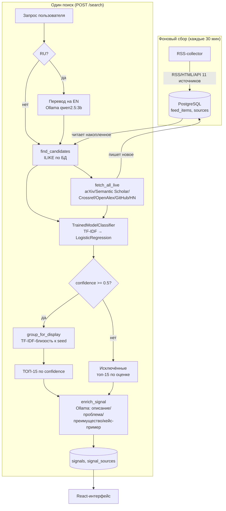

# Пайплайн обработки данных

Краткое техническое описание — как запрос пользователя превращается в
ТОП-15 слабых сигналов. Методология отбора признаков и обучения модели
подробно описана отдельно: [`Модель_и_методология/Методология_и_инструкция.md`](../Модель_и_методология/Методология_и_инструкция.md)
(94.7% точность на 76 контрольных публикациях, confusion matrix, feature
importance) — здесь не дублируется, только даётся системный контекст.

## Архитектура

## Шаги (`backend/app/pipeline/orchestrator.py::run_search`)

1. **Перевод запроса** (`enrichment.py::translate_query_to_english`) — если
   запрос не на английском, переводится через Ollama (`temperature=0`,
   детерминированно) до поиска. Оригинал сохраняется в БД без изменений,
   переведённая версия используется только для поиска кандидатов.
2. **Поиск кандидатов**:
   - `candidates.py::find_candidates` — ILIKE по заголовку/summary в
     накопленном корпусе (`feed_items`, пополняется RSS-collector'ом).
   - `live_sources.py::fetch_all_live` — параллельный live-поиск по 6
     внешним API (arXiv, Semantic Scholar, Crossref, OpenAlex, GitHub,
     Hacker News); найденное сразу пишется в ту же таблицу `feed_items`
     (дедуп по `url_hash`), обогащая корпус для будущих запросов.
3. **Скоринг** — `classifier.py::TrainedModelClassifier.score()` на
   каждого кандидата: TF-IDF-векторизация → LogisticRegression → 3 класса
   (слабый сигнал / зрелая технология / шум) + `key_predictors` (топ
   термов текста, реально повлиявших на класс — word-level
   интерпретируемость, не хардкод категорий).
4. **Отбор**:
   - прошедшие порог (`confidence >= SIGNAL_SCORE_THRESHOLD`, 0.5) —
     кандидаты в сигналы;
   - остальные — в «Исключённые» (топ-15 по оценке среди отклонённых,
     `SEARCH_EXCLUDED_LIMIT`), с явной причиной (низкая уверенность
     либо класс «зрелая технология»).
5. **Группировка для отображения** (`display_grouping.py`) — похожие
   кандидаты внутри уже отфильтрованного топа схлопываются в одну
   карточку по TF-IDF-близости к исходному seed-кандидату группы (не к
   последнему добавленному — иначе цепное слипание разных тем). На
   скоринг не влияет, только на то, сколько источников показано у одного
   сигнала.
6. **ТОП-15** — `SEARCH_TOP_N`, сортировка по confidence.
7. **LLM-обогащение** (`enrichment.py::enrich_signal`) — для каждого
   сигнала (и включённого, и исключённого) локальная Ollama
   (qwen2.5:3b) генерирует описание технологии, решаемую проблему,
   потенциальное преимущество и кейс-пример строго по тексту источника
   (`format="json"` — грамматически ограниченный вывод, не парсинг
   текста на удачу). Модель не сочиняет из общих знаний — если в тексте
   нет данных, явно пишет «не указано в источнике».
8. **Запись** — `Signal`/`SignalSource` в Postgres, `is_primary` у
   источника, чей текст реально ушёл в LLM.

## Почему так, а не иначе — ключевые решения

- **Live-поиск дублирует часть логики RSS-collector** (arXiv, Semantic
  Scholar, Crossref) намеренно — backend не должен зависеть от чужого
  Docker-образа при разворачивании.
- **EN-only гейт на входе модели** (`classifier.py::_clean_model_input`)
  — модель обучена и провалидирована только на английском тексте;
  RU-запросы нормализуются переводом ещё до поиска, а не после.
- **Группировка отображения отделена от скоринга** — каждый кандидат
  получает индивидуальную оценку до группировки; группировка только
  схлопывает вывод, не может задним числом изменить, прошёл кандидат
  порог или нет.
- **Отмена поиска — только на фронте** (прекращение поллинга); пайплайн
  на бэкенде всегда доходит до конца — компромисс ради простоты, не
  требует cooperative cancellation внутри `run_search`.
